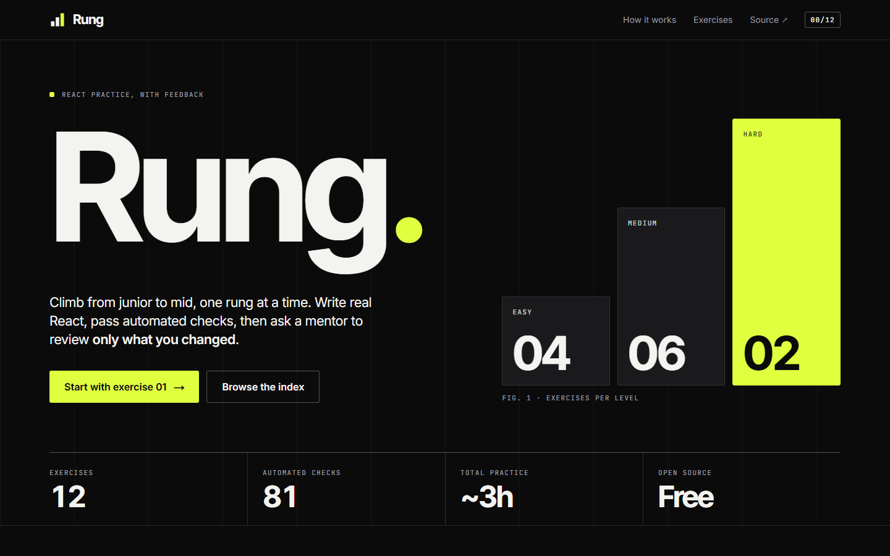
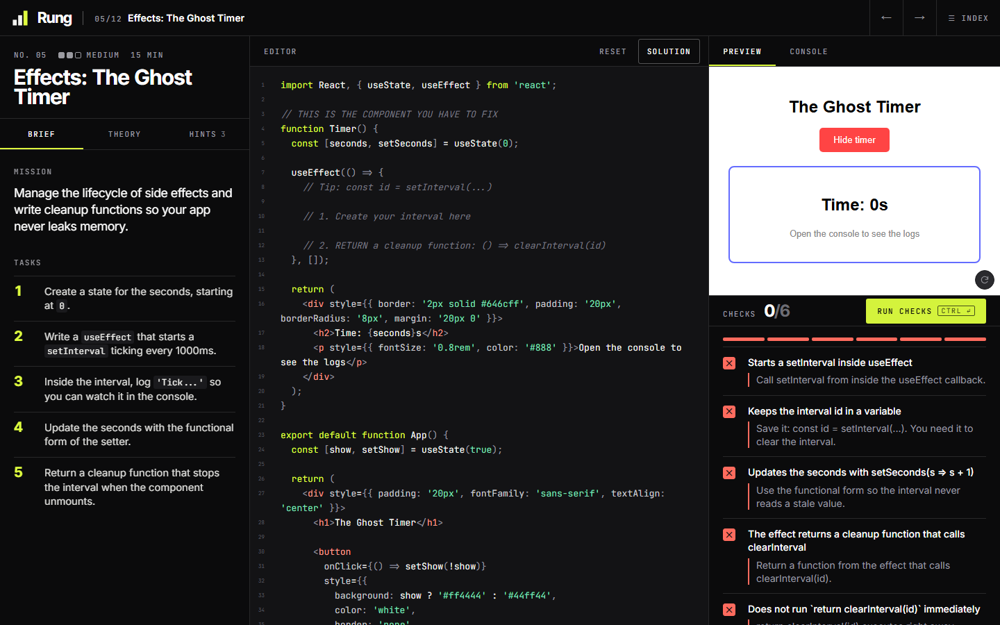
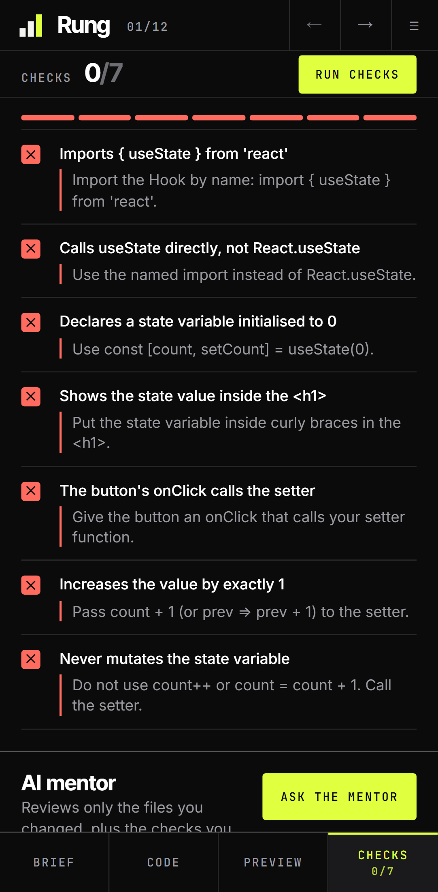
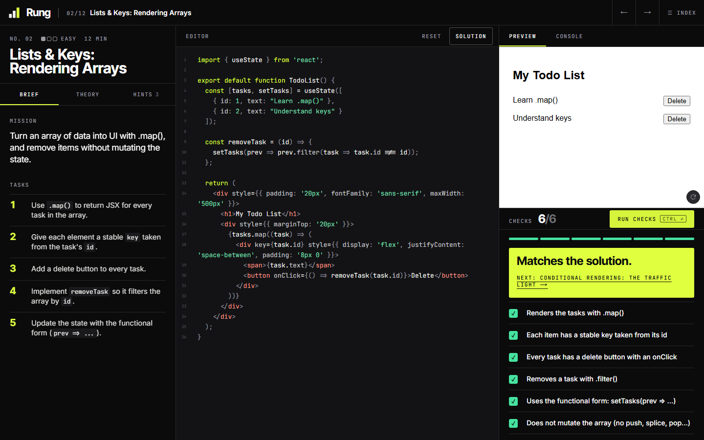

# Rung

**React practice, one rung at a time.** Write code in the browser, run automated checks that say exactly what is missing, and ask an AI mentor to review only what you changed.



## What it is

Twelve hands-on exercises that take a developer from `useState` to `useReducer`, `useContext`, custom Hooks and memoization. Each one has a brief, tasks, theory, collapsible hints and a live editor with preview and console.

What makes it different from a tutorial site is how the feedback works:

1. **Checks run in your browser, instantly.** Every requirement is verified by analysing your code's syntax tree (and, for pure logic like a reducer, by running it in a Web Worker). A failing check explains where to look. No network, no tokens, no waiting.
2. **The AI mentor explains, it does not grade.** Pass or fail is decided by the checks, so the result is deterministic and cannot be talked into approving anything. The mentor receives only the checks you missed and only the files you changed, and writes a short review.
3. **Abuse protection is built in.** Strict validation, per-client rate limits, a response cache and a server that never executes student code. See [docs/ARCHITECTURE.md](docs/ARCHITECTURE.md).

| Checks that explain what is missing | Works on a phone |
| :--- | :--- |
|  |  |



## Features

- 12 exercises across three levels, 81 automated checks.
- Instant, deterministic feedback with a hint per failed check.
- Reference solution on demand ("Reveal solution" asks twice and is recorded as such).
- Progress saved in the browser, with no account.
- Phone-friendly workspace: panes become tabs, 44px tap targets, no horizontal scroll.
- Keyboard: `Ctrl/Cmd + Enter` runs the checks, even from the editor.
- Accessible: semantic landmarks, focus management in dialogs, `prefers-reduced-motion`, axe checks in CI.
- Open source and easy to extend. See [CONTRIBUTING.md](CONTRIBUTING.md).

## Tech stack

| Area | Choice |
| :--- | :--- |
| Framework | Next.js 16 (App Router), React 19, TypeScript (strict) |
| Styling | Tailwind CSS 4, custom design tokens ("Signal"), Inter, Inter Tight and JetBrains Mono |
| Editor and preview | [Sandpack](https://sandpack.codesandbox.io/) |
| Code analysis | [acorn](https://github.com/acornjs/acorn) + acorn-jsx |
| Validation | zod |
| AI | Groq (`openai/gpt-oss-120b` by default, configurable) |
| Tests | Vitest (unit), Playwright + axe (E2E, desktop and mobile) |

## Getting started

Requires Node.js 20 or newer.

```bash
git clone https://github.com/HenryD11703/learn_react_j2m.git
cd learn_react_j2m
npm install
cp .env.example .env     # then add your GROQ_API_KEY
npm run dev
```

Open <http://localhost:3000>. Without a `GROQ_API_KEY` everything works except the AI mentor, which answers "not available". The build never needs the key.

### Environment variables

| Variable | Required | Default | Purpose |
| :--- | :--- | :--- | :--- |
| `GROQ_API_KEY` | For the mentor | none | Groq API key |
| `GROQ_MODEL` | No | `openai/gpt-oss-120b` | Groq retires models over time. Override it here |
| `REVIEW_LIMIT_PER_MINUTE` | No | `5` | Reviews per client per minute |
| `REVIEW_LIMIT_PER_DAY` | No | `60` | Reviews per client per day |
| `UPSTASH_REDIS_REST_URL` / `_TOKEN` | No | none | Shared rate-limit store for serverless |

### Scripts

| Command | What it does |
| :--- | :--- |
| `npm run dev` | Development server |
| `npm run build` / `npm start` | Production build and server |
| `npm run check` | Lint, type check and unit tests |
| `npm test` | Unit tests only |
| `npm run test:e2e` | Builds the app and runs Playwright on desktop and mobile |

## How a review works

```
 student code ──► checks (browser) ──► pass / fail + hints
                       │
                       └─ "Ask the mentor"
                              │
   POST /api/review  ◄────────┘   { slug, files, runtimeFailed }
        │
        ├─ same origin? size ok? valid shape? known exercise and files?
        ├─ does the code parse?        (otherwise 422, no model call)
        ├─ did anything change?        (otherwise 422, no model call)
        ├─ re-run static checks on the server (the client is not trusted)
        ├─ cache hit?                  (identical submission → free)
        ├─ rate limit per client
        └─ prompt = exercise goal + failed checks + CHANGED files only
              └─ model → JSON → zod → feedback
```

## Project structure

```
app/
  api/review/          Review endpoint (validation, limits, cache, model call)
  components/
    home/ ui/          Home page and shared UI (brand, level, markdown)
    workspace/         Brief, editor, preview, checks, mentor, mobile tabs
  content/react-basics/  One file per exercise: brief, starter, solution, checks
  lib/
    analysis/          AST helpers and the pure-logic runtime
    review/            Schema, prompt, cache, rate limit, model client
    checks.ts          Check runner shared by the browser and the server
    exercises-registry.ts  Curriculum order
tests/
  unit/                Checks, mutations, API route, rate limiter, prompts
  e2e/                 Playwright specs (desktop and mobile)
docs/                  Architecture notes and screenshots
```

## Quality gates for exercises

Every exercise is protected by tests that run on every change:

- the starter code parses and **fails every check** (no check passes by doing nothing);
- the reference solution **passes every check**;
- about 30 deliberately broken solutions (index as key, missing cleanup, mutated state…) must fail **exactly** the checks they should;
- in a real browser, every reference solution passes end to end, including the Web Worker checks.

## Deploying

Deploy to Vercel (or any Node host). Set `GROQ_API_KEY` in the project settings.

- Vercel's free Hobby plan is for personal, non-commercial use. Check their current terms before using it for anything else.
- On serverless platforms each instance has its own memory, so the in-memory rate limit is per instance. Set the Upstash variables for a limit that holds everywhere.
- The client IP is read from `x-forwarded-for`. That is trustworthy behind Vercel or another proxy that sets it. If you self-host without a proxy, put one in front.

## Roadmap

- Behaviour tests for UI exercises (Testing Library inside Sandpack).
- Optional accounts, so progress follows you across devices.
- More tracks: TypeScript with React, data fetching with a cache, testing.
- Light theme (the interface is dark-only for now).

## Contributing

Exercises are plain TypeScript objects and the checks are small functions, so adding one takes about an hour. See [CONTRIBUTING.md](CONTRIBUTING.md).

---

Built by [Henry Quel](https://github.com/HenryD11703).
